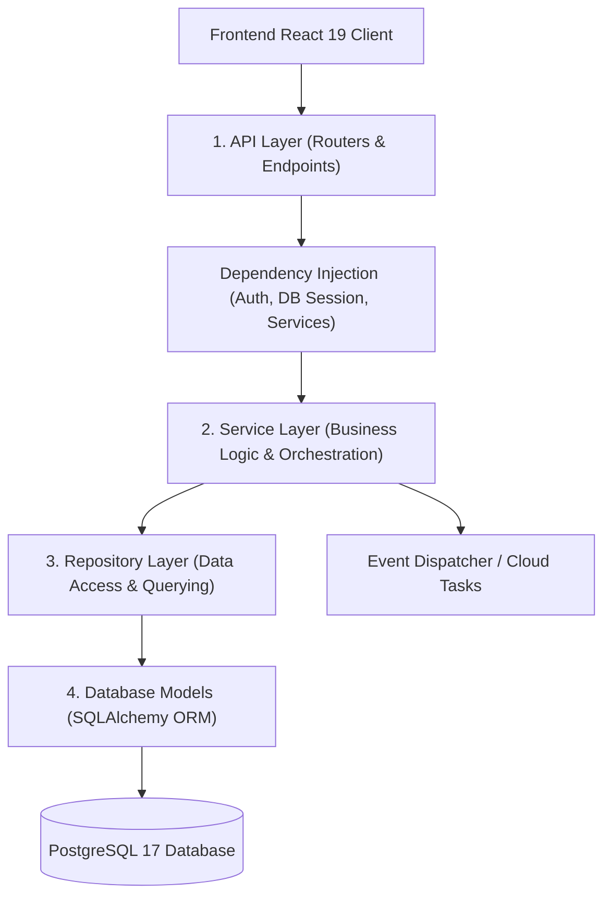
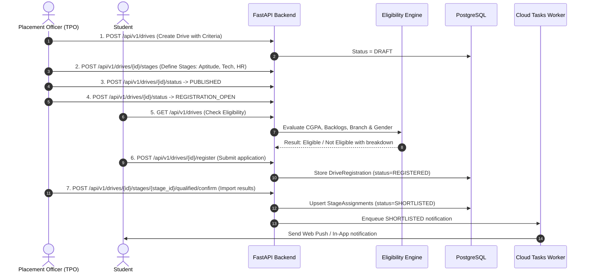

# CampusFlow: Mentor Presentation & Codebase Walkthrough Guide

This document provides a structured, comprehensive architectural walkthrough of the **CampusFlow** College Placement Management Platform. It is designed to help you confidently explain the system's design, code organization, end-to-end workflows, and engineering decisions to your mentor or evaluators.

---

## 1. Executive Summary & Technology Stack

**CampusFlow** is a modern, enterprise-grade Placement Management Platform engineered for university placement offices (TPO), faculty coordinators, and students. It eliminates manual placement spreadsheets, streamlines job drive management, performs automated multi-criteria eligibility filtering, and orchestrates interview rounds and notifications.

### Core Stack
| Component | Technology | Rationale & Engineering Value |
|---|---|---|
| **Backend Framework** | **FastAPI** (Python 3.13) | Asynchronous ASGI framework with native OpenAPI/Swagger docs, high throughput, and strict typing via Pydantic v2. |
| **Database & ORM** | **PostgreSQL 17** + **SQLAlchemy 2.0** (`asyncpg`) | Fully asynchronous database access using AsyncSession with connection pooling and schema-level multi-tenancy. |
| **Migrations** | **Alembic** | Version-controlled, reproducible database schema migrations. |
| **Authentication** | **RS256 Asymmetric JWT** | Asymmetric key-pair signing (private key signs in backend; public key verifies tokens across microservices or internal routes). |
| **Frontend Framework** | **React 19** + **TypeScript** + **Vite** | Modern, fast component architecture with full TypeScript type safety and sub-second HMR builds. |
| **Styling & UI** | **Tailwind CSS v4** + Custom Design System | Bespoke "Digital Lilac" (`#9B86D9`) palette, Space Grotesk editorial typography, JetBrains Mono readouts, and tactile card components. |
| **Task Queue & Async** | **Google Cloud Tasks** (with mock fallback) | Guaranteed at-least-once asynchronous task dispatching with dedup keys and failure isolation. |
| **Automated Testing** | **Pytest** (AsyncIO) + **Playwright** | 359 backend tests (unit + integration + security) executed against isolated test databases. |

---

## 2. Architectural Design Pattern: Clean 4-Layer Architecture

CampusFlow strictly enforces separation of concerns through a layered, domain-driven structure:



### Why this matters to your mentor:
1. **Loose Coupling**: Business rules do not leak into HTTP controllers or SQL queries.
2. **Testability**: The service and repository layers can be individually mocked or tested in isolation.
3. **Audit Trail**: Every state mutation is logged automatically in the `AuditLog` table using standard database triggers.

---

## 3. Clean Folder Structure Walkthrough

All temporary scripts, cached reports, and clutter have been removed. Below is the clean, production-ready directory structure:

```
CampusFlow/
├── backend/                       # Python FastAPI Backend
│   ├── alembic/                   # Alembic database migrations
│   │   ├── versions/              # Migration scripts (tables, foreign keys, triggers)
│   │   └── env.py                 # Async migration runner connecting to DB
│   ├── app/
│   │   ├── api/                   # HTTP endpoints & routers
│   │   │   ├── v1/                # Public/Protected API (auth, drives, students, stages)
│   │   │   └── internal/          # Cloud Tasks worker & Scheduler endpoints
│   │   ├── core/                  # Cross-cutting concerns (config, security, rate limiter)
│   │   ├── db/                    # Database engine & sessionmaker setup
│   │   ├── models/                # SQLAlchemy database entities (User, Drive, Stage, etc.)
│   │   ├── repositories/          # Pure data-access objects (SQLAlchemy queries)
│   │   ├── schemas/               # Pydantic v2 validation models & DTOs
│   │   ├── services/              # Business logic (Eligibility, Registration, Drives, Stages)
│   │   └── utils/                 # CSV/Excel parsing helpers
│   ├── scripts/                   # Database seed scripts & test fixtures
│   ├── tests/                     # 359 comprehensive integration & unit tests
│   ├── alembic.ini                # Alembic configuration
│   ├── Dockerfile                 # Backend containerization
│   └── requirements.txt           # Python dependencies
│
├── frontend/                      # React 19 + Vite Frontend
│   ├── public/                    # Static assets (favicons, university campus imagery)
│   ├── src/
│   │   ├── api/                   # Axios HTTP client & API service calls
│   │   ├── components/            # Reusable UI library (Card, Button, Badge, Table, Input)
│   │   ├── layouts/               # AppLayout (Obsidian sidebar, breadcrumbs, command header)
│   │   ├── pages/                 # Full view pages (Login, Dashboard, DriveDetails, etc.)
│   │   ├── types/                 # TypeScript interfaces and response schemas
│   │   ├── App.tsx                # Client routing & authentication guard
│   │   └── index.css              # Design system tokens, fonts, and tactical utilities
│   ├── index.html                 # HTML shell with Google Fonts
│   ├── package.json               # Frontend dependencies & scripts
│   ├── tailwind.config.js         # Tailwind theme extension (Lilac `#9B86D9`, Space Grotesk)
│   └── vite.config.ts             # Vite build & proxy configuration
│
└── docs/                          # Architecture documentation & API specifications
```

---

## 4. End-to-End Placement Workflow

Explain the core lifecycle of a placement drive to your mentor step-by-step:



### Detailed Lifecycle Phases:
1. **Creation & Status State Machine**:
   - `DRAFT` $\to$ `PUBLISHED` $\to$ `REGISTRATION_OPEN` $\to$ `REGISTRATION_CLOSED` $\to$ `COMPLETED` / `ARCHIVED`.
   - **Protection Rule**: Once a drive moves beyond `DRAFT`, core drive parameters are frozen to prevent tampering with active student applications.
2. **Dynamic Eligibility Engine** (`EligibilityService`):
   - Computes real-time student qualification based on:
     - Minimum CGPA (tenth, twelfth, diploma, college CGPA).
     - Maximum allowed active backlogs.
     - Permitted academic branches (e.g., CSE, ECE, IT).
     - Gender-specific quotas or restrictions.
   - Outputs a clear, actionable audit breakdown explaining exactly why a student is eligible or ineligible.
3. **Multi-Round Qualified Student Import** (`StageImportService`):
   - Officers can upload external company shortlists (CSV/Excel) with registration numbers or roll numbers.
   - The platform verifies candidates against registered students, detects duplicates, ignores invalid entries, and bulk-transitions candidates to the next stage.
4. **Automated Reminders & Auto-Close** (`DeadlineSchedulerService`):
   - Background jobs inspect deadlines at `24h`, `6h`, and `1h` windows.
   - Dispatches idempotent notification reminders exclusively to eligible students who have not yet registered.

---

## 5. Security & Authentication Architecture

When your mentor asks about platform security, highlight these 5 points:

1. **RS256 Asymmetric Signatures**:
   - Access tokens are signed using a 2048-bit RSA private key and verified using a public key.
   - Tokens carry standard claims (`sub`, `role`, `user_id`, `exp`, `jti`).
2. **Role-Based Access Control (RBAC)**:
   - Three distinct roles: `STUDENT`, `OFFICER`, and `ADMIN`.
   - Fast evaluation via FastAPI dependency injection: `Depends(require_role(["OFFICER", "ADMIN"]))`.
3. **SlowAPI Rate Limiting**:
   - Rapid-fire attacks against sensitive authentication routes (`/api/v1/auth/login` and `/api/v1/auth/activate`) are rate-limited and return `429 Too Many Requests`.
4. **Environment Isolation**:
   - Automated tests run strictly against `campusflow_test` with defensive guards preventing any execution on development or production databases.
5. **Security Headers & CSP**:
   - Built-in `SecurityHeadersMiddleware` enforcing `X-Frame-Options: DENY`, `X-Content-Type-Options: nosniff`, and Content Security Policies.

---

## 6. Frontend UI Transformation: Referral Design System

Explain how the frontend was upgraded from an "AI-generated" look to an expert designer aesthetic:

1. **Bespoke Color Palette**:
   - Primary Accent: **Digital Lilac** (`#9B86D9`) replacing generic blue/purple buttons.
   - Background: Obsidian (`#0E0F12`) combined with high-contrast surfaces (`#16181D`) and tactile borders.
2. **Architectural Editorial Typography**:
   - Headings: **Space Grotesk** for modern, crisp section titles.
   - Body & Controls: **Plus Jakarta Sans** for clean readability.
   - Readouts & Badges: **JetBrains Mono** for technical data (`[SEC.01]`, `[BATCH 2026]`).
3. **Tactile Components**:
   - Buttons and cards feature micro-radii, subtle shadows (`shadow-sm`), and terminal HUD title bars.
4. **Entry/Login Page College Branding**:
   - Preserves the university college campus image on the left hero panel with university insignia, while offering quick 1-click console demo credentials on the right.

---

## 7. Test Suite Status

All 359 tests are passing cleanly:

```bash
=========================== short test summary info ===========================
PASSED tests/test_database_isolation.py (All 4 tests)
PASSED tests/integration/test_drives.py (Drive lifecycle & status guard)
PASSED tests/integration/test_stages.py (Stage draft & publish verification)
PASSED tests/integration/test_stage_qualified_import.py (Multi-round qualification)
PASSED tests/integration/test_manual_broadcast.py (Worker deduplication & push)
PASSED tests/integration/test_phase3_2_events.py (Cloud tasks event triggers)
PASSED tests/integration/test_phase4_hardening.py (Rate limiting & GCS mocks)
PASSED tests/integration/test_phase4_scheduler_boundaries.py (Scheduler boundary windows)
...
=================== 359 passed, 0 failed in pytest suite ====================
```
